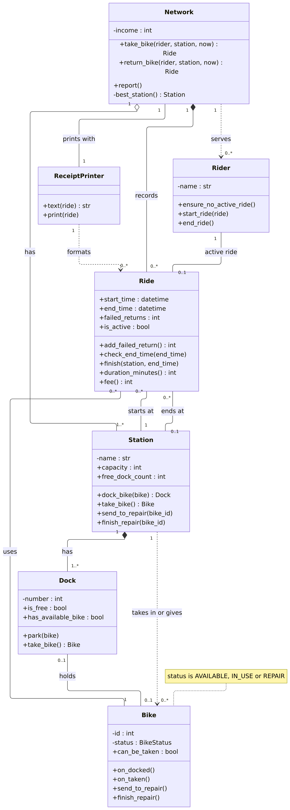

# UML class diagram: Tashkent bike sharing network

Laboratory work 5 (UML). I did not take a ready TR sheet, I used **my own project**: the bike sharing network from Laboratory work 4.

Requirement text of the project (TR):

> Tashkent bike network has stations. Every station has a fixed number of docks and a dock holds at most one bike. A rider takes a bike from any station and returns it to any free dock of any station. Every ride is recorded with start station, end station and times. First 15 minutes are free, after that the rider pays 500 sum for every started 5 minutes, but not more than 20 000 sum per ride. One rider can have one active ride only. A bike sent to repair stays in its dock and nobody can take it. The manager sees how many free docks each station has.

## Diagram



Source file: [`diagram/bike_sharing.mmd`](diagram/bike_sharing.mmd) (Mermaid).
PNG: [`diagram/bike_sharing.png`](diagram/bike_sharing.png) (more than 1500 px wide).

## Classes (7)

| Class | What it is |
|---|---|
| **Network** | runs the rides: take bike, return bike, manager report; keeps the ride history and the income |
| **Station** | has a fixed number of docks, gives a bike, takes a bike back, counts free docks |
| **Dock** | holds at most one bike |
| **Bike** | has an id and a status (AVAILABLE, IN_USE or REPAIR) |
| **Rider** | the person who rides (the TR also calls it "user"), has at most one active ride |
| **Ride** | event with data: start/end time, owns the fee rule (`fee()`) |
| **ReceiptPrinter** | makes and prints the receipt of a finished ride |

Only values, so they are **attributes** and not classes: fee (sum), times, number of docks, bike status, name, id.
The manager is an actor outside of the program, so it is not a class.

## Relationships and multiplicities

The number is written at the **far end**: "one Station has 1..* Docks" means 1..* is next to Dock.

| # | Pair | Relationship | Symbol on the diagram | Multiplicity (near first class / near second class) | Why (from the TR) |
|---|---|---|---|---|---|
| 1 | Network – Station | **aggregation** | hollow diamond at Network | Network **1** / Station **1..\*** | network has stations, they are made outside and live on without it |
| 2 | Network – Ride | **composition** | filled diamond at Network | Network **1** / Ride **0..\*** | every ride is recorded by the network, the history goes away with it |
| 3 | Station – Dock | **composition** | filled diamond at Station | Station **1** / Dock **1..\*** | every station has a fixed number of docks, docks die with the station |
| 4 | Dock – Bike | **association** | plain line | Dock **0..1** / Bike **0..1** | a dock holds at most one bike; a bike is in at most one dock (not in a dock while on a ride) |
| 5 | Station – Ride (start) | **association** | plain line, "start station of" | Station **1** / Ride **0..\*** | every ride has exactly one start station |
| 6 | Station – Ride (end) | **association** | plain line, "end station of" | Station **0..1** / Ride **0..\*** | the end station is empty while the ride is active |
| 7 | Bike – Ride | **association** | plain line, "uses" | Bike **1** / Ride **0..\*** | a ride uses one bike, one bike has many rides over time |
| 8 | Rider – Ride | **association** | plain line, "active ride" | Rider **1** / Ride **0..1** | one rider can have one active ride only |
| 9 | Network – ReceiptPrinter | **association** | plain line | Network **1** / ReceiptPrinter **1** | the network keeps one printer for the receipts |
| 10 | Network – Rider | **dependency** | dashed open arrow to Rider | Network **1** / Rider **0..\*** | the rider comes only as a parameter (`take_bike(rider, ...)`) |
| 11 | Station – Bike | **dependency** | dashed open arrow to Bike | Station **1** / Bike **0..\*** | the bike comes only as a parameter (`dock_bike(bike)`) |
| 12 | ReceiptPrinter – Ride | **dependency** | dashed open arrow to Ride | ReceiptPrinter **1** / Ride **0..\*** | the ride comes only as a parameter (`print(ride)`) |

There is **no inheritance** in this TR: nothing "is a kind of" something else. The error classes of the code are not drawn to keep the diagram within 5–10 classes.

## Files

```
README.md
diagram/
    bike_sharing.mmd    Mermaid source of the diagram
    bike_sharing.png    exported PNG (used in this README)
```

To export the PNG again:

```
npm install -g @mermaid-js/mermaid-cli
mmdc -i diagram/bike_sharing.mmd -o diagram/bike_sharing.png -s 3
```
